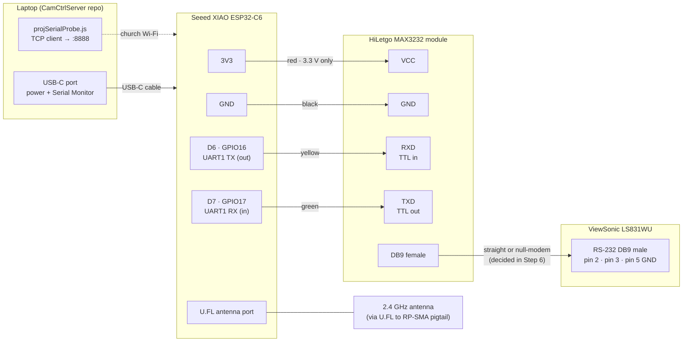
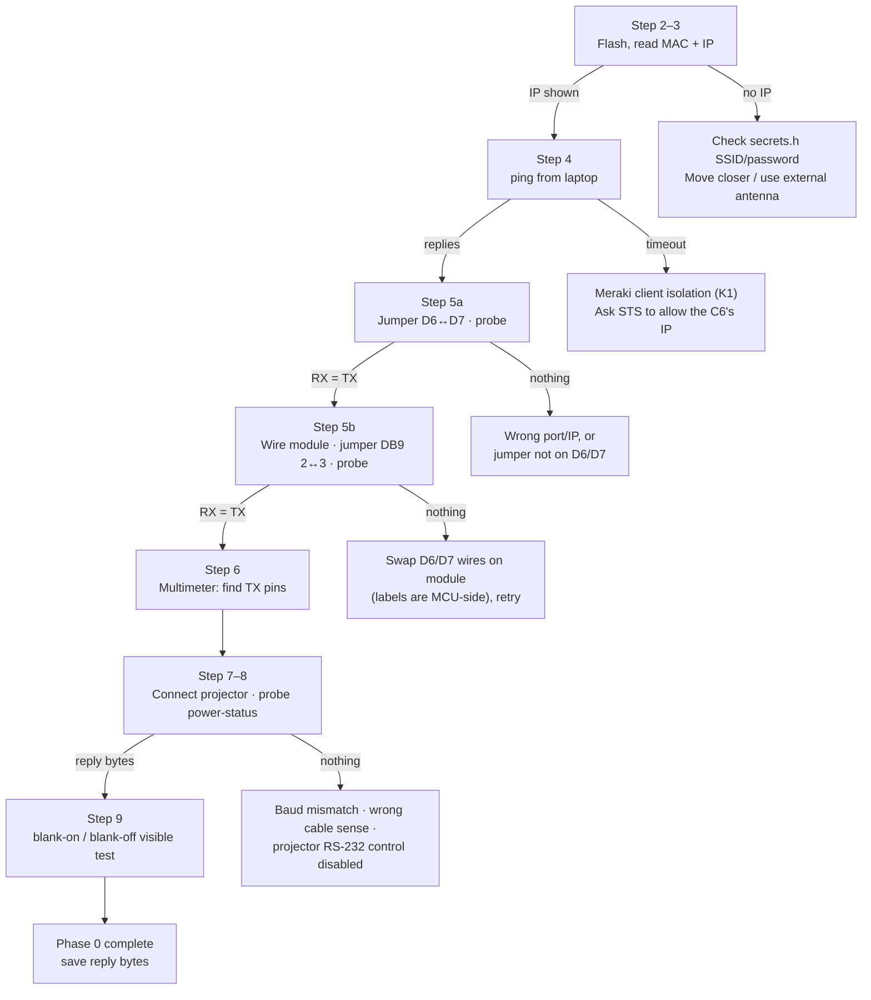

# Phase 0 Bench Test: Projector over RS-232

**Goal:** prove that the XIAO ESP32-C6 can talk to the ViewSonic LS831WU over RS-232, and capture the projector's raw reply bytes. Phase 1 firmware is built from those bytes.

**Time:** one evening. **Risk to the projector:** none if you follow the 3.3 V warning.

---

## Summary

Phase 0 doesn't build the podium controller yet. It proves the **path** the controller will use, one layer at a time:

| Layer | What we prove | How |
|---|---|---|
| 1. Wi-Fi | The C6 joins the church Wi-Fi and the laptop can reach it (Meraki client isolation, risk K1) | Serial Monitor shows an IP; `ping` from the laptop |
| 2. Bridge | Laptop → Wi-Fi → C6 UART round trip works | Jumper D6↔D7, probe sees its own bytes echoed |
| 3. Converter | C6 → MAX3232 → RS-232 levels and back works, with TX/RX on the correct pins | Jumper DB9 pins 2↔3, probe sees its own bytes echoed |
| 4. Cable sense | Whether the module and projector need a straight or crossed (null-modem) connection | Multimeter: find each side's TX pin by its idle negative voltage |
| 5. Projector | The projector accepts commands and replies | Probe `power-status`, then `blank-on` / `blank-off` with the projector on |
| 6. Cat5e *(optional tonight)* | Same as 5, over the 20 ft run from the podium | RJ45↔DB9 adapters on cat5e run A |

Each layer only adds one new thing, so a failure points at exactly one part.

The tools used:
- **Firmware:** `esp32-projector-bridge/esp32-projector-bridge.ino`, a dumb Wi-Fi ↔ serial bridge on TCP port 8888 that logs every byte as hex.
- **Laptop:** `src/tools/projSerialProbe.ts`, which sends one command and prints the raw reply. It doesn't touch the live server, which still uses PJLink.

---

## Wiring diagram



### Pin table (XIAO → module)

| XIAO pin | Signal | Module pin | Suggested wire color |
|---|---|---|---|
| **3V3** | Power | **VCC** | Red |
| **GND** | Ground | **GND** | Black |
| **D6** (GPIO16) | C6 transmits | **RXD** (module's TTL *input*) | Yellow |
| **D7** (GPIO17) | C6 receives | **TXD** (module's TTL *output*) | Green |

> ⚠️ **Power the module from 3V3, never 5V.** The module's TXD output swings to whatever VCC is. At 5 V it would feed 5 V into D7, and the C6's pins are 3.3 V only.

> **About the TXD/RXD labels:** most of these modules label the TTL pins from the *module's* point of view (TXD = data out of the module), so TX goes to RXD as above. A few label them from the *microcontroller's* point of view. **Step 5 detects this**, so don't worry about it now.
>
> ✅ **Confirmed 2026-10-24 for the HiLetgo modules on hand (FNSKU X002AJMVL1): labels are microcontroller-side.** Wire **D6 → TXD** and **D7 → RXD** (straight across, TX to TX). Module loopback passed with that wiring.

### XIAO ESP32-C6 pin locations (USB-C at the top, components facing up)

| Row (from USB end) | Left edge | Right edge |
|---|---|---|
| 1 | D0 · GPIO0 | 5V |
| 2 | D1 · GPIO1 | **GND → module GND** |
| 3 | D2 · GPIO2 | **3V3 → module VCC** |
| 4 | D3 · GPIO21 | D10 · GPIO18 |
| 5 | D4 · GPIO22 | D9 · GPIO20 |
| 6 | D5 · GPIO23 | D8 · GPIO19 |
| 7 (bottom) | **D6 · GPIO16 → module RXD** | **D7 · GPIO17 ← module TXD** |

So the four wires use the **bottom-left pad** (D6), the **bottom-right pad** (D7), and the **2nd and 3rd pads on the right** (GND, 3V3). Check against the silkscreen; Seeed prints the D-labels next to each pad.

---

## Test ladder (what to do when a step fails)



---

## Step-by-step

### Before you start (at home)

You need: the XIAO C6, one HiLetgo MAX3232 module, 4 jumper wires (female-female Dupont if the XIAO has header pins), a USB-C **data** cable (not charge-only), the antenna + U.FL pigtail, a multimeter, and one extra jumper wire or paperclip for loopback tests.

**Step 1. Check your laptop setup** (already true on this Mac as of 2026-10-11):
- Arduino IDE 2 with the **esp32 by Espressif** core 3.x. Core 3.3.8 is installed.
- `esp32-projector-bridge/secrets.h` exists with the church Wi-Fi SSID and password. It's gitignored.
- If you'll use the external antenna, open `esp32-projector-bridge/esp32-projector-bridge.ino` and set:
  ```cpp
  const bool USE_EXTERNAL_ANTENNA = true;
  ```
- Build the probe once:
  ```bash
  npx tsc
  ```

### Flash the C6

**Step 2. Attach the antenna and flash the firmware.**
1. If you're using the external antenna, snap the pigtail's U.FL end straight down onto the XIAO's antenna port until it clicks, then screw on the antenna.
2. Plug the XIAO into the laptop with USB-C.
3. Arduino IDE → **File → Open** → `esp32-projector-bridge/esp32-projector-bridge.ino`.
4. **Tools → Board → esp32 → XIAO_ESP32C6**. **Tools → USB CDC On Boot → Enabled**. **Tools → Port →** the `usbmodem` port.
5. Click **Upload**. If it hangs at `Connecting...`: hold **BOOT**, tap **RESET** (or unplug/replug USB), release **BOOT**, then click Upload again.

**Step 3. Read the MAC and IP.** Open **Tools → Serial Monitor** at **115200** baud, then press **RESET** on the XIAO. You should see:
```
ESP32-C6 Projector Bridge starting
Serial1: 9600 baud 8N1, RX=D7 (GPIO17), TX=D6 (GPIO16)
MAC address: xx:xx:xx:xx:xx:xx
Connecting to Wi-Fi "<church SSID>"...
Wi-Fi connected. IP: 192.168.x.x  RSSI: -55 dBm  TCP port: 8888
```
- **Write down the MAC and IP.** The MAC is what your STS needs for a DHCP reservation. `comport.ts` notes a previous reservation at `192.168.108.18`; if a different board was reserved, this one may get a different IP.
- **RSSI:** better than −70 dBm is good. Worse than −80 means try the external antenna or move closer.

### Prove the network and bridge (no projector yet)

**Step 4. Ping from the laptop** (laptop on church Wi-Fi):
```bash
ping -c 5 192.168.108.18
```
Use the IP from Step 3. **Replies = no client isolation (K1 cleared).** Timeouts while the Serial Monitor shows the C6 connected = the network blocks device-to-device traffic. Stop here and talk to your STS; the plan's fallback is the controller's own Wi-Fi hotspot.

**Step 5a. Bridge loopback.** Unplug everything from D6 and D7. Connect **one jumper directly from D6 to D7**. Then run:
```bash
node dist/tools/projSerialProbe.js power-status 192.168.108.18
```
**Pass:** the `RX` line shows the **same bytes as the `TX` line** (`07 14 00 05 00 34 00 00 11 00 5e`). The Serial Monitor shows both a `TCP->RS232:` and an `RS232->TCP:` line.

> Until `replyIsComplete()` is implemented, the probe always ends with "Timed out before the reply looked complete". That's expected; judge by the `RX` bytes.

**Step 5b. Module loopback.** Remove the D6–D7 jumper. Wire the module per the pin table, **3V3 to VCC**. On the module's DB9 female connector, **jumper pin 2 to pin 3** (a paperclip or a bare jumper wire). Run the same probe command.
- **Pass:** RX = TX again. The module, its power, and TX/RX wiring are all correct.
- **Nothing back:** the module labels its pins from the microcontroller's side. **Swap the D6 and D7 wires at the module** and retry. Leave the swap in place if it passes.
- **Still nothing:** check that VCC reads ~3.3 V and GND is connected; try a second module.

Remove the DB9 loopback jumper when done.

### Work out the cable sense (multimeter)

**Step 6. Find each side's TX pin.** RS-232 transmit pins **idle at a negative voltage** (about −5 to −9 V). Receive pins sit near 0 V. Set the multimeter to DC volts with the black probe on **pin 5 (GND)**:

| Measure | Expect |
|---|---|
| Module DB9 pin 2 → pin 5 (module powered) | One of pins 2 or 3 reads about **−5.5 V**. That's the module's TX |
| Module DB9 pin 3 → pin 5 | The other reads about **0 V**. That's the module's RX |
| Projector DB9 pin 2 → pin 5 (projector plugged in, standby is fine) | One of pins 2 or 3 reads **negative**. That's the projector's TX |
| Projector DB9 pin 3 → pin 5 | The other reads about **0 V** |

DB9 pins are numbered on the face of the connector: male `1 2 3 4 5` top row, `6 7 8 9` bottom row; female is mirrored.

**Rule: each TX must land on the other side's RX.**
- Module TX pin number **≠** projector TX pin number (for example module TX = 2, projector TX = 3): plug the module **straight** into the projector.
- **Same** pin number on both: you need a **null-modem** adapter (it swaps pins 2 and 3), or cross the wires on the cat5e adapter in Step 10.

> Projectors are usually wired like a PC (TX on pin 3), and these modules are usually wired to plug into a PC (TX on pin 2), so **straight-through is most likely**. Measure anyway; it takes a minute and settles it.

### Talk to the projector

**Step 7. Set the projector's baud rate.** On the projector's on-screen menu, find the **RS-232 / Baud Rate** setting (usually under the system or advanced settings) and set **9600**. It must match `PROJ_BAUD` in the sketch.
- If 9600 isn't offered, choose the closest option, change `PROJ_BAUD` to match, and re-upload.
- If the menu has an option for standby power or network/RS-232 control in standby, set it to the mode that keeps control active (often "Normal" rather than "Eco"). Otherwise the projector may ignore commands while in standby.

**Step 8. First real command.** Connect the module's DB9 to the projector (straight or via null-modem per Step 6). Projector in **standby** is fine. Run:
```bash
node dist/tools/projSerialProbe.js power-status 192.168.108.18
```
- **Pass:** `RX` shows bytes that are **not** a copy of TX. **Copy the whole RX line into `docs/projector-controller-plan.md` under K5.** This is the reply format Phase 1 needs.
- **Nothing back:** in order: (1) cable sense (redo Step 6); (2) baud mismatch; (3) try with the projector **on**, since some models ignore RS-232 in eco standby.

**Step 9. Visible test.** Turn the projector **on** (remote is fine) and wait for the picture. Then:
```bash
node dist/tools/projSerialProbe.js blank-on 192.168.108.18
```
```bash
node dist/tools/projSerialProbe.js blank-off 192.168.108.18
```
The image should blank and return. Save both reply lines. Optionally test `power-off` and `power-on` last, because power commands start a cool-down or warm-up you'll have to wait out.

### Optional: over the cat5e (Phase 0 step 6 in the plan)

**Step 10.** You need two **RJ45-to-DB9 modular adapters** (the kind with loose pins you push into the DB9 shell): a **DB9 male** adapter to plug into the module's DB9 female, and a **DB9 female** adapter for the projector's DB9 male. Wire both so the cat5e carries:

| Signal | cat5e pair | Module side DB9 | Projector side DB9 |
|---|---|---|---|
| Module TX → projector RX | Orange | module TX pin (from Step 6) | projector RX pin |
| Projector TX → module RX | Green | module RX pin | projector TX pin |
| Ground | Orange-white + green-white | 5 | 5 |

Because you choose the pins inside the adapters, **this is where you build in the crossover** if Step 6 said you need one. Repeat Steps 8–9 from the podium.

---

## Done when

- [ ] Laptop can ping the C6 on the church Wi-Fi (K1 cleared, or escalated to STS)
- [ ] Module loopback passes, with the correct D6/D7 orientation recorded
- [ ] Cable sense recorded: straight or null-modem
- [ ] Projector baud set to match `PROJ_BAUD`
- [ ] Raw reply bytes for `power-status`, `blank-on`, `blank-off` saved in the plan (K5)
- [ ] *(Optional)* Same results over cat5e run A
- [ ] C6 MAC address sent to the STS for a DHCP reservation

## Write these down during the test

| Item | Value |
|---|---|
| C6 MAC address | (see Serial Monitor) |
| C6 IP address / RSSI | 192.168.110.32 on the church Wi-Fi (2026-10-24) |
| Ping from laptop works? | ✅ Yes on the church Wi-Fi: no client isolation (K1 cleared) |
| D6/D7 swapped at module? | Yes: D6 → TXD, D7 → RXD (labels are MCU-side) |
| Module DB9 TX pin | **Pin 2** (−6 V idle); pin 3 = RX (0 V) |
| Projector DB9 TX pin | **Pin 3** (−6 V idle); pin 2 = RX (0 V) |
| Straight or null-modem? | **Straight** (module TX 2 → projector RX 2; projector TX 3 → module RX 3) |
| Projector baud setting | 9600 |
| `power-status` reply (standby) | `05 14 00 03 00 00 00 00 17` — reported **immediately** after power-off, while the fan was still cooling |
| `power-status` reply (on) | `05 14 00 03 00 00 00 01 18` — reported within 10 s of power-on, during warm-up |
| `power-off` / `power-on` replies | Both `03 14 00 00 00 14` (accepted). Cool-down until the fan stopped: about 1–2 min |
| `blank-on` reply | `03 14 00 00 00 14` when it changes state; `00 14 00 00 00 14` when already blanked |
| `blank-status` reply | blanked `05 14 00 03 00 00 00 01 18` · showing `05 14 00 03 00 00 00 00 17` |
| `blank-off` reply | `03 14 00 00 00 14` when it changes state; `00 14 00 00 00 14` when already unblanked |

## Incidents

- **2026-10-24:** module #1 was powered with VCC/GND reversed at home. It passed loopback, then at the church returned a truncated reply (5 of 9 bytes) and went silent in both directions. A fresh module fixed it immediately. **Any MAX3232 module that has had reversed power is suspect; discard it.**
