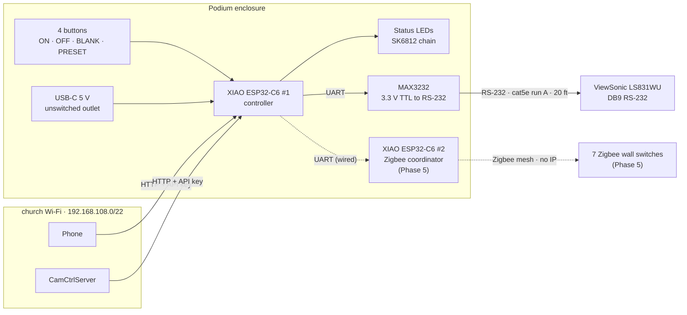
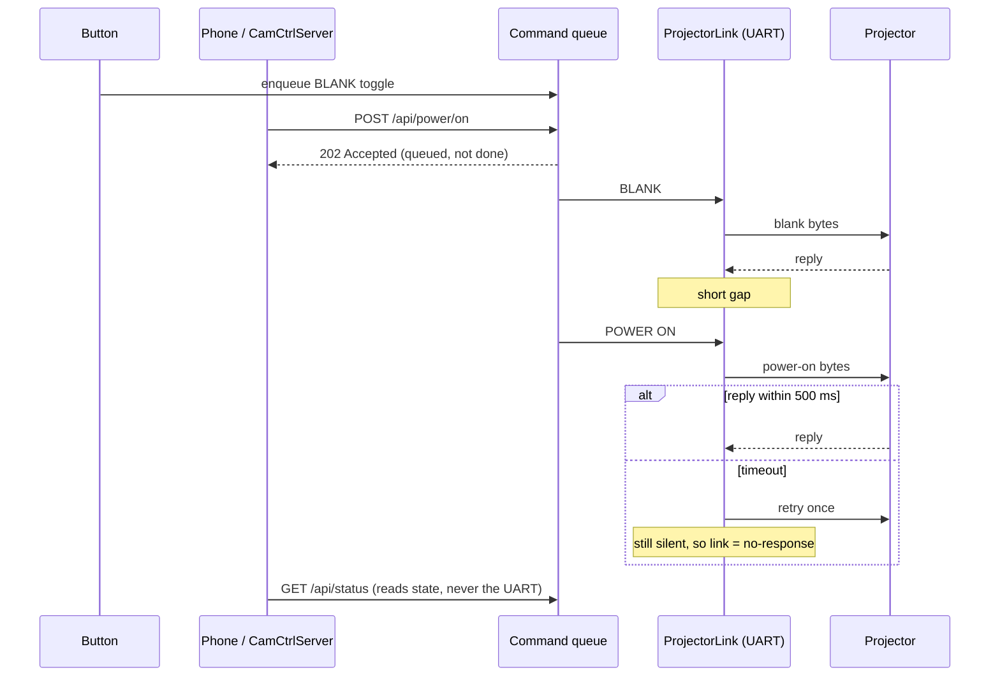
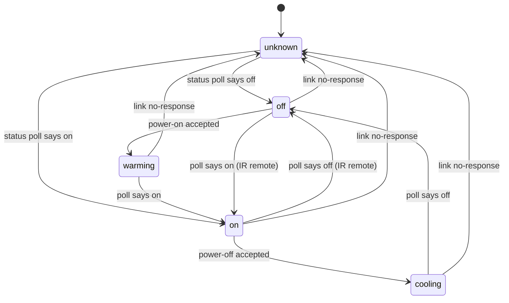
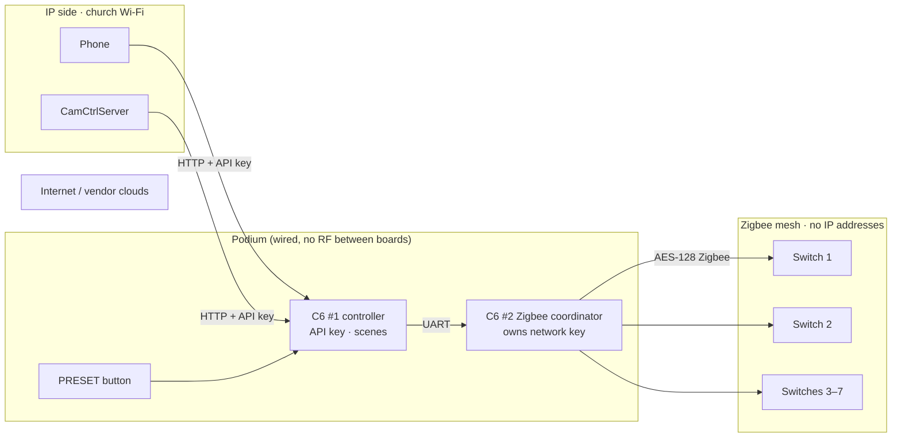
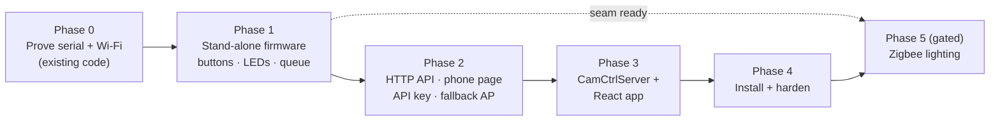

# Projector Controller — Architecture Plan

**Status:** Draft v4 · Phase 0 code done, bench test pending (v2 reviewed; v3 and v4 fold in owner answers, see [Revision history](#revision-history))
**Date:** 2026-10-11
**Goal:** Reliable control of the ViewSonic LS831WU that does not depend on its flaky built-in network port, CamCtrlServer, or the church Wi-Fi being up. Leave room for privacy-respecting room-lighting control later.

---

## TL;DR

Build a **stand-alone controller at the podium**: an XIAO ESP32-C6 plus a MAX3232, talking **RS-232 to the projector over a 20 ft cat5e run**.

- The controller owns the projector. It is the only thing that talks to it.
- **Hard buttons work with no network at all.** Phones and CamCtrlServer are network clients of the controller.
- All inputs (buttons, phone, CamCtrlServer, status polling) feed **one command queue**, so commands never collide on the serial line.
- CamCtrlServer gets a small driver that forwards `/api/proj/*` to the controller. The React app keeps working unchanged.
- The **PRESET button triggers a lighting *scene***. In Phase 5, scenes drive 7 commercial **Zigbee** wall switches through a second XIAO C6 that you own and run, so **no switch is ever on IP or talks to a vendor cloud**. IP control of the lights still works, through the controller's API.

---

## Requirements

| # | Requirement | Source |
|---|---|---|
| R1 | Presenter can power on, power off, blank/unblank, and switch between a lighting preset and normal with physical buttons | User |
| R2 | Buttons work even if Wi-Fi, CamCtrlServer, or the laptop are down | User ("stand alone") |
| R3 | Phone can control the projector directly | User |
| R4 | CamCtrlServer and the existing React app keep controlling the projector | User |
| R5 | A multi-color LED shows projector state | User |
| R6 | State stays truthful even if someone uses the IR remote | Derived |
| R7 | Random devices on church Wi-Fi cannot switch the projector or lights | Derived (the church Wi-Fi is a public network) |
| R8 | No secrets in git | Derived |
| R9 | *(Future)* Lighting presets control up to **7 single-pole switch circuits** | User |
| R10 | *(Future)* Wall switches keep working as a manual override if the controller is dead | Derived (safety, people in a dark room) |
| R11 | *(Future)* Light switches are **commercial, listed, and work on their own** | User |
| R12 | *(Future)* Light switches **don't compromise IP security** (no cloud, no data collection), yet lights are controllable **over IP** | User |

---

## Key design decisions

### D1. Serial (RS-232), not the projector's LAN port
ViewSonic has warned that IP control on firmware 1.3 is unreliable. RS-232 is the control path AV integrators rely on. The command bytes are the same ones already in `src/Models/Projector.ts`; ViewSonic uses the same frame format on both transports. That means the existing command table carries over.

### D2. Controller at the **podium**, RS-232 over the cat5e
| Option | Pros | Cons |
|---|---|---|
| **A. ESP32 at podium, RS-232 over cat5e (chosen)** | Buttons and LED wiring are short. Power is easy (USB brick at the podium). Easy to reach for reflashing or a reset. Nothing powered in the ceiling. | Uses one of the two cat5e runs |
| B. ESP32 at projector, button wires over cat5e | Short serial run | Needs power in the ceiling. Hard to service. Button wires double as antennas |
| C. Two ESP32s (projector + podium) | Each end is simple | Twice the firmware and failure points. Links depend on Wi-Fi or ESP-NOW |

The **MAX3232 sits at the podium end**. RS-232's ±5–6 V signaling is designed to travel down a cable; 3.3 V TTL isn't. At the projector end you only need a passive RJ45→DB9 adapter, with no power. At 20 ft, RS-232 has a large margin at any baud rate.

### D3. One command queue, one owner of the serial line
Several inputs can fire at the same moment. The projector expects one command, then its reply, then the next. The firmware therefore:

- Puts every request (button, HTTP, status poll) **into a FIFO queue**.
- Sends **one command at a time**, waits for the reply or a timeout (~500 ms), then leaves a short gap.
- Retries once on timeout, then marks the link `no-response`.

HTTP handlers and button handlers **never touch the UART directly**. That rule is what makes the multi-input design safe.

### D4. Controller is the source of truth for state
The firmware polls power status every ~5 s, and every 1 s for 10 s after any command. It also polls blank status. It tracks:

- `power`: `off | warming | on | cooling | unknown`
- `blank`: on or off
- `scene`: current scene name
- `link`: `ok | no-response`

The LED, the phone page, and CamCtrlServer all read this state. They don't guess. This covers R6, the IR remote.

> **Bench finding 2026-10-24:** `power-status` is binary (`01` on / `00` off) and flips the moment a power command is accepted. The projector does **not** report warming or cooling over RS-232. The firmware derives `warming` and `cooling` from its own timers, started when a power command gets `03` (or when a poll sees the state flip because of the IR remote). Measured cool-down was about 1–2 min until the fan stopped; time the warm-up on the next visit.

### D5. Buttons are idempotent where it matters
| Button | Short press | Long press (≥2 s) | Why |
|---|---|---|---|
| **ON** | Power on | — | Pressing it when the projector is already on is harmless |
| **OFF** | Nothing (LED flashes "hold to turn off") | Power off | Stops someone bumping it mid-meeting and starting a cool-down that can't be undone |
| **BLANK** | Toggle blank | — | Toggling is safe because D4 tracks real state |
| **PRESET** | Toggle lighting scene: preset ↔ normal | Force "normal" | Long press is a guaranteed "get me back to normal" |

Separate ON and OFF buttons beat a single power toggle: if the state is ever `unknown`, a toggle could do the opposite of what the presenter wants. A 3-button variant (ON = tap, OFF = hold the same button) is possible if panel space is tight.

During `warming` and `cooling`, the projector ignores power commands. The queue **holds** power commands until the projector reaches a stable state instead of sending them into the void.

### D6. Status LEDs: one pixel per button (SK6812 chain)
A single LED that changes color forces presenters to learn a color code. One pixel beside each button says "this button's thing is active":

| Pixel | Color / pattern | Meaning |
|---|---|---|
| ON/OFF | Dim red | Standby |
| | Amber, slow blink | Warming up / cooling down |
| | Green | On |
| | Red, fast blink | No response from projector (cable or projector problem) |
| BLANK | Blue | Image blanked |
| PRESET | Purple | Lighting preset active |
| | Purple, slow blink | Some lights didn't confirm the scene (Phase 5) |
| (any) | One white flash | Button press accepted |

The whole chain uses a single GPIO. Run SK6812 pixels from 5 V (VBUS). They accept 3.3 V data more reliably than some WS2812 clones.

### D7. HTTP API on the controller (semantic, POST for actions)
The controller speaks **meaning** ("power on"), not bytes. It owns the ViewSonic protocol and, later, the Zigbee network; clients don't need to know either.

| Method | Path | Notes |
|---|---|---|
| GET | `/` | Phone control page (single HTML file served from flash) |
| GET | `/api/status` | `{power, blank, scene, link, lights[7], lighting, wifiRssi, uptimeS, fw}` |
| POST | `/api/power/on` · `/api/power/off` | Returns `202` + current status. The client polls `/api/status` |
| POST | `/api/blank/on` · `/off` · `/toggle` | |
| POST | `/api/scene/:name` · `/api/scene/toggle` | `name` ∈ scene table (e.g. `normal`, `presentation`) |
| POST | `/api/lights/:n/on` · `/off` | *(Phase 5)* Individual circuit, `n` = 1–7. This is the "control the lights over IP" path (R12) |

- **POST, not GET, for actions.** Link previews, browser prefetch, and crawlers issue GETs. A GET should never be able to turn the projector or lights off.
- **`X-Api-Key` header required on POSTs** (R7). Mandatory, not optional, because the church Wi-Fi is a public network. The phone page asks for a PIN once and stores it in `localStorage`. CamCtrlServer stores it in `.env`. Failed attempts are rate-limited.
- Return **202 Accepted** without waiting for the projector. Handlers stay instant and never block the loop. The client learns the real outcome from `/api/status`. This is honest: "queued" isn't "done."

### D8. CamCtrlServer becomes a client, not a driver

> **Superseded 2026-10-24 (implemented):** the controller **emulates a PJLink projector on TCP 4352** (`podium-controller/PjlinkServer.h`). The existing server works unchanged: set `PROJ_PJLINK_HOST` to the controller's reserved IP and `PROJ_PJLINK_PASSWORD` to its `PJLINK_PASSWORD`. Reverting to the projector's own PJLink is a one-line `.env` change. The bullets below were the original plan.
- Add `PROJ_CONTROL=ESP32 | PJLINK` to `.env`. With `ESP32`, `/api/proj/power|blank/:cmd` forward to the controller over HTTP (Node `fetch`, 2 s timeout). With `PJLINK`, today's path runs (`projPJLinkPort`, added upstream after v1 of this plan).
- Add `GET /api/proj/status` (proxied) so the React app can show real state.
- Add `GET /api/scene/:name` and *(Phase 5)* `GET /api/lights/:n/:cmd`, proxied to the controller's POST routes. Scenes and lights belong to the room, not the projector, so they get their own route prefix.
- **Keep the existing GET routes** on CamCtrlServer so `ts-cam-app` doesn't change. Only the controller enforces POST.
- `comport.ts` must **only construct the transport that's selected**. `projTcpPort.ts` and `projDirectPort.ts` connect as soon as they're imported and retry every 5 s forever; keep them behind `require()` in the selected branch, as `comport.ts` does today.
- `Projector.ts` (RS-232 bytes) stays as the reference command table for the firmware port; `ProjectorPJLink.ts` stays for `PJLINK` mode.

### D9. Firmware stack: Arduino core 3.3.x via Arduino IDE / `arduino-cli`
- The existing sketches are Arduino, and core **3.3.8 is already installed** on this Mac. Core 3.x also includes Espressif's Zigbee library, used in Phase 5.
- PlatformIO's official ESP32 platform lags on Arduino 3.x, which the C6 requires. It would need the community *pioarduino* fork, which adds friction.
- **ESPHome was considered.** It gives OTA, fallback AP, debouncing, and a web UI for free. But its request/response serial parsing and command-queue semantics need custom C++ components anyway, and its generic REST API doesn't match D7. It would fight the design.
- Use the built-in synchronous `WebServer`, not ESPAsyncWebServer. Handlers only enqueue, so they're fast, and that drops a dependency.

### D10. Firmware modules (one `.ino` + small headers)
| Module | Responsibility |
|---|---|
| `ProjectorLink` | UART, FIFO queue, one-in-flight, reply framing, timeout/retry, link health |
| `ProjectorState` | State machine from replies + poll results; warm-up/cool-down timers |
| `Commands.h` | Byte table ported from `Projector.ts` |
| `Scenes` | Scene table: name → `{projector actions, lights: 7-bit mask + values}`. PRESET button and `/api/scene` both go through it |
| `LightingDriver` | Interface `setCircuits(mask, values)` + `getCircuits()`. **Stub now** (reports `lighting: "not-installed"`); Zigbee-link driver in Phase 5 |
| `Buttons` | Debounce, short/long press → enqueue |
| `StatusLeds` | Renders state to pixels |
| `Net` | Wi-Fi STA (reuses the scan-for-best-2.4 GHz + PMF workaround from `esp32-proj-bridge.ino`), reconnect watchdog, mDNS `projector.local`, fallback AP |
| `WebApi` | Routes from D7, API-key check, rate limit, serves phone page |
| `secrets.h` | SSID, Wi-Fi password, **API key**, fallback-AP password. **Gitignored**; `secrets.example.h` committed |

`loop()` stays non-blocking (state machines, no `delay()` beyond a few ms). The **task watchdog** reboots the board if anything hangs. Buttons and LEDs come back within ~2 s of a reboot.

### D11. Network
- The controller joins the **meetinghouse's public Wi-Fi**, which the old bridge also used. Everyone in the building can reach it, so R7's API key is **mandatory**.
- Ask the Meraki admin for a **DHCP reservation** for the controller's MAC. `projector.local` (mDNS) is a convenience only, because Meraki may not forward mDNS between clients.
- **Client isolation is a real risk on a public SSID** (K1). Phase 0 tests it before anything depends on it.
- **Fallback AP:** if the controller can't join Wi-Fi within 2 min, it starts a WPA2 AP `Projector-Ctrl` (password in `secrets.h`). The phone page is then at `192.168.4.1`. It retries the church Wi-Fi every 5 min. This keeps the phone path (R3) available even when the building network is down.

### D12. Lighting: Zigbee switches with a coordinator you own
**Why Zigbee meets R11 and R12 at the same time:** a Zigbee switch has **no IP stack**. It can't reach the internet, phone home, or be port-scanned. It only talks to the Zigbee coordinator it's paired to. With **your** C6 as that coordinator, there's no vendor hub and no vendor cloud. IP control still works, because your controller translates `POST /api/lights/3/on` into a Zigbee On/Off command. The **only IP device in the lighting system is firmware you wrote**.

*(`CLOUD` is deliberately unconnected: the switches have no route to it.)*

**Approval and safety gate** (unchanged from v3): building electrical changes need the **Facilities Manager's** OK, **listed (UL/ETL) devices**, and a qualified electrician. The ESP32 never switches mains. The wall paddle on each switch is the manual override (R10).

#### Switch selection criteria
| Criterion | Why |
|---|---|
| **Zigbee 3.0 certified** (on the CSA-IoT certified product list) | Works with *any* standard coordinator, including ours. No proprietary hub required |
| **Zigbee radio only.** No Wi-Fi or Bluetooth radio in the switch | No radio that could reach IP = no data-collection path (excludes Feit, Tuya/Smart Life Wi-Fi devices, and similar) |
| **UL or ETL listed** | Code requirement; Facilities Manager will ask |
| **Works fully at the paddle with no coordinator** | R10/R11: lights work even if the podium is dead or unpaired |
| **On/off (relay), not a dimmer**, unless dimming is wanted | Single-pole on/off circuits with LED drivers flicker on the wrong dimmer |
| **Neutral requirement matches the box** | Older boxes often lack a neutral; no-neutral switches need a minimum load |
| **Voltage rating matches the circuit** | Commercial buildings sometimes run lighting at **277 V**; most smart switches are 120 V only |
| **Standard On/Off cluster** | It's the simplest, most universal part of Zigbee, so our coordinator needs nothing vendor-specific |

**Candidates to evaluate** (verify current model, listing, and Zigbee 3.0 certification before buying): **Inovelli Blue Series** (Zigbee 3.0, popular in local-only setups); **Jasco / Enbrighten Zigbee** (GE-branded line). Avoid "works with *Brand* app" devices that need a vendor hub to pair.

#### Coordinator options
| Option | Stand-alone? | Maturity | Choose when |
|---|---|---|---|
| **A1. Second XIAO C6 running Espressif's Zigbee coordinator, UART to the controller (leaning)** | **Yes.** No network or computer needed | Lower than commercial hubs, but we only use the On/Off cluster | Default. Matches R2's stand-alone principle |
| A2. Zigbee2MQTT on a local Raspberry Pi + Zigbee coordinator (USB or PoE) | No (depends on the Pi and LAN) | High; supports thousands of devices, handles OTA firmware updates | A1's prototype hits device quirks you can't work around |

Why a **second** C6 instead of one board doing both: the C6 has a single 2.4 GHz radio. Wi-Fi and Zigbee can share it by taking turns, but a coordinator that's off-channel while Wi-Fi works is a reliability compromise. You own 15 boards; a dedicated one is cheap.

**Zigbee network hygiene:** the coordinator generates a random network key stored in its flash (never in git). Permit-join is open **only** during a deliberate pairing window (e.g. hold BLANK + PRESET for 5 s). Use install codes if the chosen switches support them.

#### Alternatives considered
| Option | Verdict |
|---|---|
| Wi-Fi relays/switches (Shelly, Feit, Tuya-based) | **Rejected.** Each switch becomes an IP device on a public network. Several vendors require or default to cloud accounts (R12) |
| Lutron (Caséta / RadioRA 3) | Commercial-grade and very reliable, but uses Lutron's own RF and needs a Lutron bridge on IP, set up with Lutron's app and account. Viable if the Facilities Manager prefers a known brand |
| Existing AV/lighting control (Extron/QSC or a lighting panel) | **Check first.** If the room already has controllable lighting, it may be the cheapest route |

---

## Hardware

### Bill of materials (owned unless marked)
| Part | Qty | Notes |
|---|---|---|
| XIAO ESP32-C6 | 1 (+1 spare); +1 in Phase 5 | Use the external antenna if the podium is metal (set `WIFI_ANT_CONFIG` GPIO14 HIGH) |
| HiLetgo mini MAX3232 (no DB9) | 1 | Goes inside the podium enclosure |
| 16 mm momentary buttons | 4 | **Buy** |
| SK6812 pixels | 4 | **Buy** (or a short strip) |
| RJ45 keystone jack + enclosure | 1 | **Buy** |
| RJ45 → DB9 **female** modular adapter | 1 | **Buy**. Goes on the projector's DB9 male port |
| USB-C 5 V supply | 1 | Plug into an **unswitched** podium outlet |
| HiLetgo MAX3232 with DB9 | — | For bench testing at the projector (Phase 0) |
| Zigbee 3.0 wall switches | 7 | **Buy in Phase 5**, after criteria + FM approval |

### Pin map, controller (XIAO ESP32-C6, verified against core 3.3.8 `variants/XIAO_ESP32C6/pins_arduino.h`)
| XIAO label | GPIO | Use |
|---|---|---|
| D6 | 16 | UART TX → MAX3232 T1IN |
| D7 | 17 | UART RX ← MAX3232 R1OUT |
| D0 | 0 | Button ON (to GND, `INPUT_PULLUP`) |
| D1 | 1 | Button OFF |
| D2 | 2 | Button BLANK |
| D3 | 21 | Button PRESET |
| D10 | 18 | LED chain data (via 330 Ω) |
| D4 / D5 | 22 / 23 | **Reserved:** I2C (SDA/SCL) for a button expander if more scene buttons are added |
| D8 / D9 | 19 / 20 | **Reserved:** `Serial0` link to the Phase 5 Zigbee coordinator |
| 3V3 / GND | — | MAX3232 VCC / GND |
| VBUS (5 V) | — | LED chain power (+ 100–470 µF cap across it) |

Use **`Serial1.begin(baud, SERIAL_8N1, D7, D6)`** with the `D6`/`D7` constants, never raw GPIO numbers. See the pin-bug finding below.

### Cat5e runs (two, both free, ~20 ft, 4-pair UTP)
- **Run A:** RS-232 to the projector (wiring below).
- **Run B:** spare. Terminate both ends and label it. Uses: an instant swap if run A fails, or patching the projector's LAN port to the podium for diagnostics.
- If either cable has a drain wire or shield, **bond it to ground at the podium end only**. Bonding at both ends can create a ground loop through the projector's chassis.

### Cat5e wiring, run A (RS-232, 3 conductors)
| Signal | Podium (MAX3232) | cat5e | Projector DB9 (verify against manual) |
|---|---|---|---|
| TX (to projector) | T1OUT | Orange | Pin 2 (RXD) |
| RX (from projector) | R1IN | Green | Pin 3 (TXD) |
| GND | GND | Orange-white + Green-white | Pin 5 |

Pair each signal with a ground on its twisted pair. Blue and brown pairs stay unused (or carry a second RS-232 device later).

---

## Phases (each ends in a test you can do)

### Phase 0: Prove the serial path with code that already exists (≈1 evening)
1. ✅ Fix the pin bug in `esp32-projector-bridge.ino` (the XIAO C6 sketch): `Serial1` on `D7`/`D6`. Credentials moved to gitignored `secrets.h`. Sketch compiles for `esp32:esp32:XIAO_ESP32C6`.
2. ✅ Add `src/tools/projSerialProbe.ts`: sends one `Projector.ts` byte command to the bridge and prints the raw reply. It's standalone, because the live server now uses **PJLink** (`comport.ts` → `projPJLinkPort`), and swapping transports would break it.
3. **Set the projector's RS-232 baud to 9600** to match `PROJ_BAUD` in the sketch.
4. Bench test at the projector with the DB9 MAX3232 module: `node dist/tools/projSerialProbe.js power-status`. **Save the raw reply bytes**; Phase 1's parser is built from them.
5. From the laptop, `ping` the bridge's Wi-Fi IP (reservation `192.168.108.18` per `comport.ts`). This **tests Meraki client isolation on the church Wi-Fi** (K1).
6. Repeat step 4 through cat5e run A from the podium.

**Exit:** projector answers power status over RS-232 through the cat5e, and the laptop can reach the ESP32 over Wi-Fi.

### Phase 1: Stand-alone firmware, no network (R1, R2, R5, R6)
`ProjectorLink`, `ProjectorState`, `Commands.h`, `Scenes` + stub `LightingDriver`, `Buttons`, `StatusLeds`, watchdog.
**Exit:** with Wi-Fi off, all four buttons work. The LEDs follow the IR remote within ~5 s. Pulling the serial cable shows fast red within ~2 s.

### Phase 2: Network API + phone page (R3, R7)
`Net`, `WebApi`, phone page, API key + rate limit, fallback AP.
**Exit:** phone controls everything. A POST without the key gets `401`. Turning the router off brings up `Projector-Ctrl` within 2 min.

### Phase 3: CamCtrlServer + React app (R4)
D8 changes; add the Preset button and a status indicator in `ts-cam-app`.
**Exit:** the React app shows live state, and a button press and an app press at the same moment both apply in order.

### Phase 4: Install and harden
Enclosure, labels, a laminated one-card guide for presenters ("Green = on. Hold OFF 2 seconds."), ArduinoOTA (password-protected), a 1-week soak test with a log of reconnects/timeouts at `/api/status`.

### Phase 5: Lighting (separate project, gated)
1. Inventory the 7 circuits: location, **voltage (120 V or 277 V)**, load type (LED/fluorescent/incandescent), neutral present in the box?
2. Get Facilities Manager approval. Pick switches against the D12 criteria.
3. **Bench prototype:** C6 #2 as coordinator + **one** switch on a bench pigtail (installed by the electrician, or a listed plug-in Zigbee 3.0 test device). Prove pair, on/off, state report, and paddle-without-coordinator.
4. Add the UART link C6 #1 ↔ C6 #2 and the real `LightingDriver`. Define scenes.
5. Electrician installs all 7. Pair them in the deliberate pairing window.

**Exit:** PRESET applies the scene; holding PRESET restores normal; `POST /api/lights/n/on|off` works; each wall switch still works with the podium unplugged.

---

## Risks and open questions

| # | Item | Mitigation / question |
|---|---|---|
| ~~K1~~ | ✅ **Cleared 2026-10-24:** laptop pinged the C6 on the church Wi-Fi. Was: **Client isolation** on the church Wi-Fi (public SSIDs often have it on) may block laptop/phone ↔ controller | Tested in Phase 0 step 5. If blocked: ask the admin to allow the controller's reserved IP, or use the controller's own AP |
| ~~K5~~ | ~~Projector reply format unknown~~ | **Resolved 2026-10-24:** `power-status` → `05 14 00 03 00 00 00 01 18`. Same frame as commands: type, `14 00`, 2-byte LE length, payload, checksum (sum of bytes after type). Reply types: `05` = status data (last payload byte = value, e.g. power 01 on, blank 01/00), `03` = command accepted, `00` = refused (e.g. already in that state). **Firmware must treat `00` after a redundant command as "already there", not a link error.** |
| K6 | Church network policy on adding devices | Ask the stake technology specialist; you'll need them for the DHCP reservation anyway |
| K7 | Zigbee coordinator on ESP32 is less mature than commercial hubs | Only the On/Off cluster is used; Phase 5 step 3 prototypes one switch; A2 (Zigbee2MQTT) is the fallback |
| K8 | **API key travels over plain HTTP** on a network whose Wi-Fi password is public, so a determined person on the church Wi-Fi could capture it | Threat model is prank-level, and wall switches + IR remote remain overrides. Rate limiting + `/api/status` logging in Phase 2. Upgrade path if needed: per-request HMAC with timestamp (pure-JS HMAC in the phone page; WebCrypto isn't available over plain HTTP) |
| K9 | Lighting circuits may be 277 V or lack neutrals | Phase 5 step 1 inventory before choosing switches |
| ~~K2~~ | ~~What is the lighting preset?~~ | Resolved v3: 7 single-pole switch circuits |
| ~~K3~~ | ~~Cat5e length~~ | Resolved v4: ~20 ft, ample margin |
| ~~K4~~ | ~~Is the cat5e free?~~ | Resolved v3: two free runs |

---

## Findings during exploration (fix regardless of this plan)

1. **XIAO pin mapping is wrong in `esp32-docs/PINOUT.md` and both projector-bridge sketches.** They list D6 = GPIO21 / D7 = GPIO20, which is the **XIAO ESP32-C3** mapping. On the **C6**, D6 = GPIO16 and D7 = GPIO17; GPIO21 is D3 and GPIO20 is D9. The earlier "failed serial connection" may have been this, not the projector.
2. **Use `Serial1`, not `Serial2`, on the C6.** The C6 has only two full-featured UARTs (UART0/UART1). In core 3.x, `Serial2` refers to the low-power UART, which has pin restrictions. Confirm on the bench if you want to keep `Serial2`.
3. **Wi-Fi credentials are hard-coded in `esp32-proj-bridge/esp32-proj-bridge.ino`** (pushed to a public repo since `0beda30`). The owner confirmed this is the public the church Wi-Fi SSID, so **no rotation or history scrub is needed**. Still move credentials into a gitignored `secrets.h`, because the new firmware's API key and AP password *are* secret and belong in the same file.

---

## Revision history

### v2: review pass on v1
| v1 draft said | v2 says | Why |
|---|---|---|
| MAX3232 at the projector, TTL down the cat5e | MAX3232 at podium, RS-232 down the cat5e | TTL isn't made for long cables; this also removes the need for power in the ceiling |
| Single power toggle button | Separate ON / hold-to-OFF | Toggle is unsafe when state is `unknown`; prevents accidental mid-meeting shutdown |
| Handlers write to UART | All inputs → one queue | Simultaneous inputs would interleave bytes on the wire |
| Mirror CamCtrlServer's GET routes on the ESP32 | POST + API key on the ESP32; GET kept only on CamCtrlServer | Prefetch/link previews and guest-network devices |
| Start by writing new firmware | Phase 0 reuses existing bridge + `projTcpPort.ts` | Proves wiring, baud, reply format, and Wi-Fi isolation before investing in firmware |
| One multi-color LED | One pixel per button | Presenters shouldn't need a color legend |
| Power commands sent immediately | Held during warm-up/cool-down | Projector silently ignores them then |
| `comport.ts` unchanged | Construct only the selected transport | Avoids endless reconnect spam to the old IP |
| Wi-Fi only | Fallback AP | Phone path survives a building network outage |

### v3: owner answers
| Answer | Plan change |
|---|---|
| Preset = 7 single-pole light switches, future | PRESET is a **scene** trigger. Added `Scenes` + stub `LightingDriver`, `/api/scene/*`, R9/R10, D12, Phase 5. Long-press PRESET = force normal. Reserved D4/D5 and D8/D9 |
| Two free cat5e runs | Run A = RS-232, run B = labeled spare |
| Projector has a baud setting | 9600; baud is config, not code |

### v4: owner answers
| Answer | Plan change |
|---|---|
| Cat5e is ~20 ft, 4-pair UTP | K3 resolved. Added shield/drain bonding note. Baud choice is now about matching existing code, not margin |
| Wi-Fi is the public meetinghouse SSID; no rotation | Finding 3 downgraded. D11 now names the public SSID. API key **mandatory**. Added K8 (key over plain HTTP) with an honest threat model |
| Commercial, stand-alone switches; no IP-security compromise; still IP-controllable | D12 rewritten: Zigbee 3.0 switches (no IP stack) + coordinator you own. Added R11/R12, selection criteria, coordinator options A1/A2, rejected Wi-Fi switches, `/api/lights/:n`, Zigbee network hygiene |
| Mermaid, not ASCII | System, queue sequence, power state, lighting topology, and phase diagrams are Mermaid |
